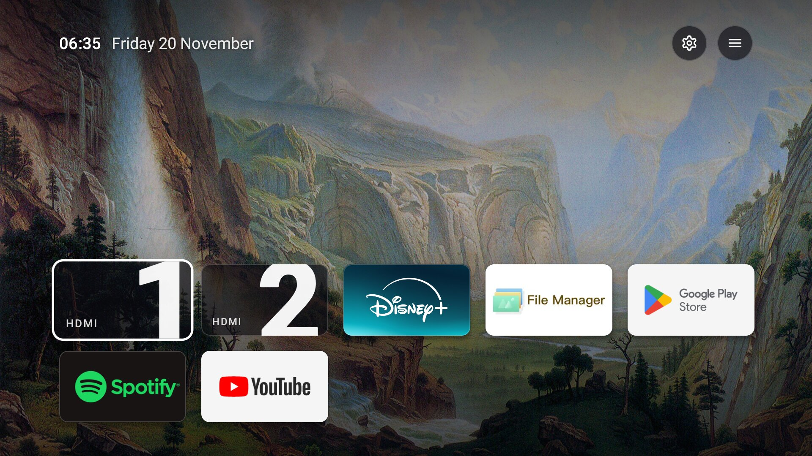
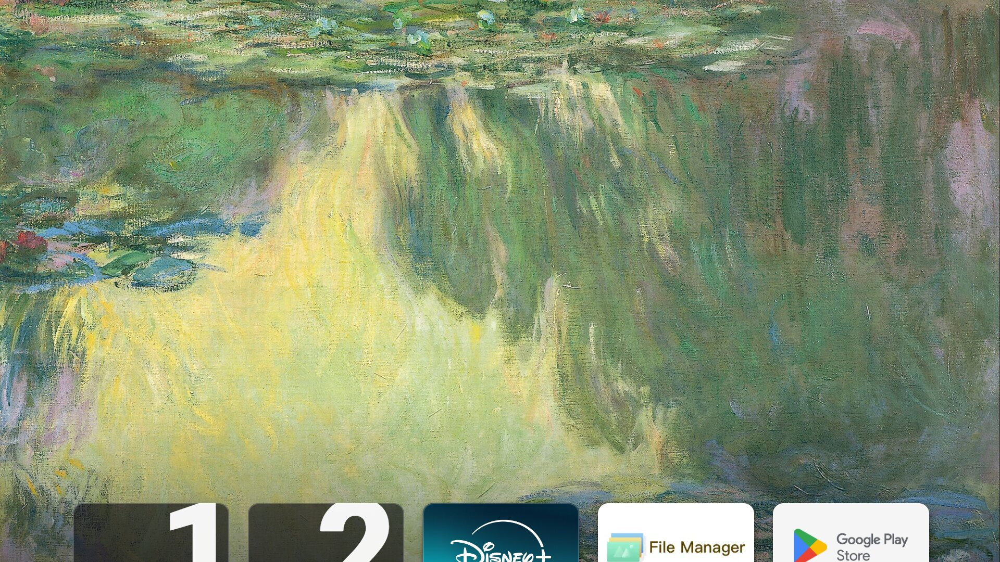
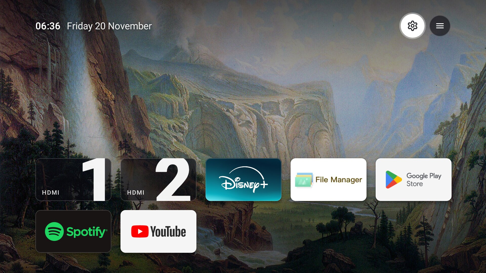

# xgimi-projector-custom-launcher

An ad-free, art-first home screen for XGIMI projectors running Android TV.



The stock Google TV launcher fills the screen with promoted shows and autoplaying trailers. This one shows a random print from your own art collection instead, with your apps in a small grid. HDMI inputs and the XGIMI quick menu are first-class buttons that actually work, unlike in most third-party launchers.

It's built for the **XGIMI Horizon Pro** (model XK03H, Android TV 11). Other XGIMI models that use the same system apps will probably work too. On non-XGIMI Android TV devices everything except the HDMI cards and quick menu should work.

## Features

- **Gallery wall.** A new random print appears every time the home screen is shown. After 10 seconds without input it goes idle: just the art, with the top of the app grid peeking up from the bottom. Any key wakes it.
- **HDMI inputs as cards.** HDMI 1 is focused by default. They switch inputs the same way XGIMI's own source picker does (see [how it works](#how-hdmi-switching-and-the-quick-menu-work)).
- **Quick menu and settings buttons** at the top right. Press Up from the top row to reach them, and Up again to go back to idle.
- **All your apps, automatically.** Every installed TV app gets a card using its own banner. New installs appear at the end. Long-press OK on an app to move it left or right, or hide it.
- **Deep links** for automation, e.g. a Home Assistant button that switches to HDMI 1.
- No ads, no tracking, no network access, no dependencies. It's about 1,500 lines of plain Java and builds without Gradle.

| Idle | Icons focused |
|---|---|
|  |  |

The paintings in the screenshots (Monet's *Water Lilies*, 1907, and Bierstadt's *Half Dome, Yosemite*) are in the public domain and included in [`docs/example-art`](docs/example-art).

## Install

You need `adb` and network debugging turned on on the projector:

1. **Settings → Device Preferences → About**: press *Build* 7 times to enable developer options.
2. **Developer options**: turn on *USB debugging* (on the Horizon Pro this also enables ADB over the network on port 5555).
3. `adb connect <projector-ip>:5555` and accept the prompt on the projector (tick *Always allow*).

Then build and install:

```sh
DEVICE=<projector-ip>:5555 ./build.sh --art docs/example-art
```

`build.sh` compiles, signs and installs the APK. It also grants the storage permission the art folder needs, sets the launcher as the default home app, and pushes the example art.

### Removing the stock launcher

The Google TV launcher is a system app, so it can't be uninstalled, but disabling it stops it running entirely:

```sh
adb shell pm disable-user --user 0 com.google.android.tvlauncher        # stop it
adb shell pm disable-user --user 0 com.google.android.tvrecommendations # the promoted rows
# undo with: adb shell pm enable <package>
```

Keep `com.google.android.tv.remote.service` enabled. Home Assistant's Android TV Remote integration (and the Google TV remote app) use it.

## Art

Prints are read at runtime from either of these folders, so adding art never needs a rebuild:

- `/sdcard/Pictures/LauncherArt/`
- `/sdcard/Android/data/com.domdomegg.launcher/files/art/` (needs no permission, but is deleted on uninstall)

```sh
adb push my-print.jpg /sdcard/Pictures/LauncherArt/
```

Images should be **1920×1080** (they're centre-cropped to fill the screen). Most prints are portrait, so it's worth choosing each crop by hand. Prints with a solid-colour background can be extended sideways with that colour instead of cropped, and some pattern prints work rotated.

## Home Assistant

The launcher handles `projector://` links, which Home Assistant's [Android TV Remote](https://www.home-assistant.io/integrations/androidtv_remote/) integration can open with `remote.turn_on`:

| Link | Does |
|---|---|
| `projector://input/HDMI1` | Switch to HDMI 1 |
| `projector://input/HDMI2` | Switch to HDMI 2 |
| `projector://menu` | Open the XGIMI quick menu |
| `projector://settings` | Open Android settings |
| `projector://home` | Go to the home screen |

```yaml
action: remote.turn_on
target:
  entity_id: remote.projector
data:
  activity: projector://input/HDMI1
```

## How HDMI switching and the quick menu work

On these projectors the standard Android approach to switching input (`ACTION_VIEW` on a `TvContract` passthrough URI) does nothing, because no installed app handles it. That's why the HDMI buttons in most third-party launchers don't work. XGIMI's own source picker (in `com.xgimi.misckey`) instead starts an exported activity in XGIMI's media player:

```sh
adb shell am start -n com.xgimi.xhplayer/.InputActivity --es sw HDMI1
```

The quick menu (the remote's settings button) is a service in the same system app:

```sh
adb shell am startservice -n com.xgimi.misckey/.component.MiscKeyService -a com.xgimi.fast.menu
```

Home Assistant's Android TV Remote integration can only send a plain `VIEW` intent for a link, not these, so the launcher includes a small invisible `projector://` deep-link activity that translates them.

## Building

Requirements:

- the Android SDK with `build-tools/34.0.0` and `platforms/android-34` (`ANDROID_HOME`, default `~/Library/Android/sdk`)
- JDK 17 or 21 (`JAVA_HOME`; d8 34 can't read newer class files)

```sh
./build.sh                  # build + install on DEVICE (or adb's only device)
./build.sh --no-install     # just build build/projector-launcher.apk
./build.sh --art DIR        # also push a folder of images
```

There's no Gradle and no AndroidX: `aapt2`, `javac`, `d8`, `zipalign` and `apksigner` are called directly. A signing key (`debug.keystore`) is generated on the first build.

| File | What it does |
|---|---|
| `MainActivity.java` | Layout, awake/idle states, D-pad navigation, app list, long-press menu |
| `CardView.java` | App banner and HDMI "big numeral" cards, focus animation |
| `IconButton.java` | Settings / quick menu buttons |
| `ArtLoader.java` | Picks and decodes a random print off the UI thread |
| `Grid.java` | Fixed 5-column card grid |
| `DeepLinkActivity.java` | `projector://` links |
| `Actions.java` | HDMI switching, quick menu, settings, home |

## Credits

- Settings icon from [Lucide](https://lucide.dev) (ISC licence)
- Example art: Claude Monet, *Water Lilies* (1907); Albert Bierstadt, *Half Dome, Yosemite*. Both are in the public domain.

## Licence

MIT
